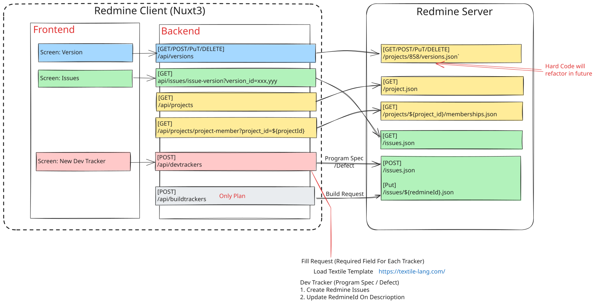

# Simple Redmine Client

* A simple redmine client to manange redmine data via REST API https://www.redmine.org/projects/redmine/wiki/Rest_api
* Ver 1.0 - 2.0 Develop with Nuxt3 + vuetify + TypeScript
* Ver 3.0 Upgrade to Nuxt4 + Nuxt UI + TypeScript https://github.com/pingkunga/simple-redmine-client/pull/5

# Overview Architecture



See [CLAUDE.md](./CLAUDE.md) for a written breakdown of the layers, Redmine integration pattern, auth model, and other conventions (kept up to date for AI-assisted development).

# Feature

- [x] List Versions (On Specific Project Id)
- [x] List Issue from versions 
- [x] New Dev Tracker (Program Spec / Defect)
- [x] Set your own access Token
- [x] New Build Common Tracker (Build Request)
- [x] Build Invest Product Set (buildinvset) release-request builder — DOTNET / Spring / VB6 build requests, with saved per-layout templates
- [x] Issue Relationship Graph — visualize related/child issues (Vue Flow + Dagre layout), expandable nodes, root-issue highlighting, and a per-user personal/server Redmine token toggle
- [x] DevTracker Redmine request payload externalized into JSON + textile templates (`public/IssueTemplate/DevTracker/`)
- [x] Collapsible sidebar (desktop) to reclaim screen width
- [x] Add Unit Test (Initial)
- [x] Add API admin/release/thisweek-release to get current week release data (Version with due date in current week) and send to Line Notify
- [x] Add API admin/release/send-release-mail to send current week release data to specific email address
- [x] Add Admin Page to manage Release Notii Email Template (Subject / Body) with some variable such as {{versionName}} / {{versionDueDate}} / {{versionIssues}} (List of Issues in Version with name and tracker type)
- [x] Add Simple Auth with password (No Register / No User Management) to protect Admin Page
- [x] Add API to List Branches from GitLab and Cache in Memory with Incremental Sync (Pull Latest 100 Events and Merge to Cache) 
- [x] Add Admin Page to List Branches with Pagination (PER_PAGE = 5) and Search (Search by Branch Name)

# Plan List

- Add Coverage Report
- Add Component Test
- Add API Test
- Refactor Code eq. remove hardcode to config such as List Versions (On Specific Project Id) — DevTracker's Redmine payload shape is now template-driven (`public/IssueTemplate/DevTracker/`), but custom_fields IDs are still constants baked into those JSON templates, so still open
- Add MCP
- Add Chat

# Nuxt Minimal Starter

Look at the [Nuxt documentation](https://nuxt.com/docs/getting-started/introduction) to learn more.

## Setup

Make sure to install dependencies:

```bash
# npm
npm install

# pnpm
pnpm install

# yarn
yarn install

# bun
bun install
```

## Development Server

Start the development server on `http://localhost:3000`:

```bash
# npm
npm run dev

# pnpm
pnpm dev

# yarn
yarn dev

# bun
bun run dev
```

## Production

Build the application for production:

```bash
# npm
npm run build

# pnpm
pnpm build

# yarn
yarn build

# bun
bun run build
```

Locally preview production build:

```bash
# npm
npm run preview

# pnpm
pnpm preview

# yarn
yarn preview

# bun
bun run preview
```

Check out the [deployment documentation](https://nuxt.com/docs/getting-started/deployment) for more information.

## Use Lib

```
bun add axios
bun add driver.js
bun add @dagrejs/dagre @vue-flow/core @vue-flow/background @vue-flow/controls
```

## Build & Run

```
docker build --pull -t bun-redmine:0.3.3rc9 .

docker build --pull -t bun-redmine:0.3.3rc9 . --no-cache --progress=plain 

docker run -d -p 3000:3000 --env-file .\.env --name bun-redmine bun-redmine:0.3.3rc9

docker tag bun-redmine:0.3.3rc9 pingkunga/bun-redmine:0.3.3rc9
docker push pingkunga/bun-redmine:0.3.3rc9
```

### AI chat limits

Per-request caps for `/api/chat`, all optional (unset, empty or invalid values use the default):

| Env var | Default | Meaning |
|---|---|---|
| `NUXT_CHAT_MAX_STEPS` | 6 (1-20) | Max model/tool rounds per question |
| `NUXT_CHAT_MAX_OUTPUT_TOKENS` | 1500 (100-8000) | Max answer tokens per model call |
| `NUXT_CHAT_REQUEST_TIMEOUT_MS` | 150000 (10000-600000) | Hard time limit in ms |

Fifty seconds before the time limit (never earlier than half of it) the assistant stops calling tools and
answers from the data it already has, saying the summary is partial.

### AI chat transcripts

`/api/chat` records each model call (question, answer, tool inputs/outputs, client IP) to
`data/chat-logs/YYYY-MM-DD.jsonl` so prompts and tools can be improved later. Files older than
`NUXT_CHAT_LOG_RETENTION_DAYS` (default 30) are deleted automatically; `NUXT_CHAT_LOG_ENABLED=false` turns it off;
`NUXT_CHAT_LOG_DIR` changes the folder.

The folder lives inside the container, so mount a volume or the logs vanish with it (it must be writable by user `bun`):

```
docker run -d -p 3000:3000 --env-file .\.env -v D:\chat-logs:/app/data/chat-logs --name bun-redmine bun-redmine:0.3.3rc9
```

Read them with PowerShell: `Get-Content .\2026-10-19.jsonl | ConvertFrom-Json | Select-Object ts, outcome, question, answer`.
The files contain Redmine/GitLab content, so restrict who can read the folder.

## Test

```
bun add -d vitest @vitest/ui @vue/test-utils jsdom

bun test
```

$headers = @{
    "Content-Type" = "application/json"
    "x-api-key"    = "YOU_API_KEY"
}

$body = @{
    projectId  = 858
    recipients = @("chatri.ngam@sample.co.th")
} | ConvertTo-Json

Invoke-RestMethod -Method Post -Uri "http://192.168.1.222:3002/api/release/send-release-mail" -Headers $headers -Body $body


Invoke-RestMethod -Method Post -Uri "http://localhost:3000/api/release/thisweek-release" -Headers $headers 
